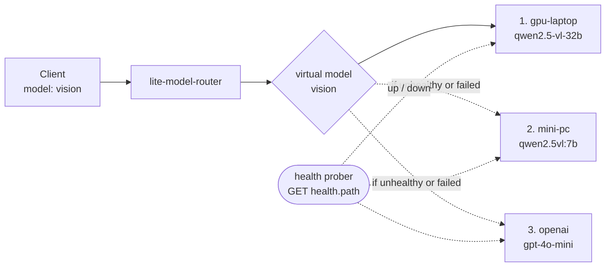
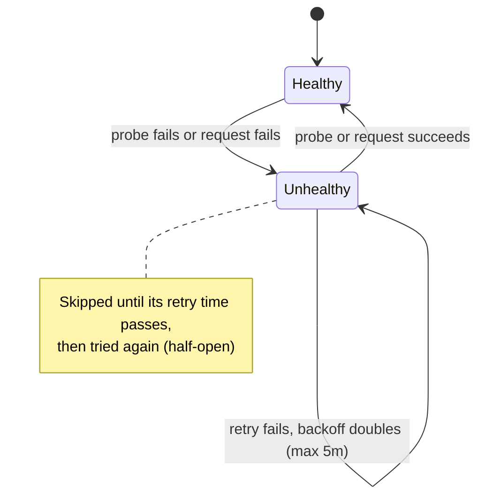
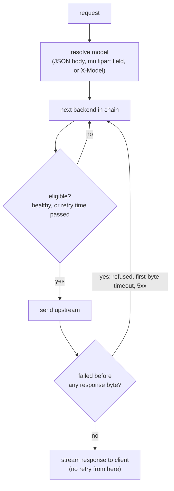

<div align="center">


# lite-model-router

**One model name. An ordered, health-checked fallback chain of real backends.**

[](https://github.com/zhuanyi/lite-model-router/actions/workflows/ci.yml)
[](LICENSE)
[](go.mod)
[](https://github.com/zhuanyi/lite-model-router/stargazers)
[](https://github.com/zhuanyi/lite-model-router/commits/main)
[](https://github.com/zhuanyi/lite-model-router/pulls)

[Quick start](#-quick-start) · [How it works](#-how-it-works) · [Configuration](#-configuration) · [Endpoints](#-status-endpoints) · [Design](docs/PLAN.md) · [Review record](docs/REVIEW.md)

</div>

---

A tiny reverse proxy for OpenAI- and Anthropic-compatible model endpoints, with **virtual models**: one model name that resolves to an ordered, health-checked fallback chain of real backends ("use the big GPU box when it's online, otherwise the always-on mini PC, otherwise the cloud").

## 🤔 Why

Clients usually hard-code one base URL and one model. When that backend is a laptop that sleeps or a box that reboots, every client config has to change. `lite-model-router` keeps the client config fixed (`model: "vision"`) and moves the "which backend is up right now" decision into one small process.

## ✨ Features

- 📦 **One static binary**, Go standard library only (zero third-party dependencies), one JSON config file.
- 🔀 **Transparent pass-through** for everything under `/v1/` (chat/completions, completions, embeddings, images, audio, responses, Anthropic `/v1/messages`, ...). The body is read only to resolve and rewrite `model`; streaming (SSE) is passed through and flushed as it arrives.
- 🩺 **Active health probes + passive failure detection** with exponential backoff (capped at 5m).
- 🔁 **Safe failover**: a request that fails *before* any response byte reaches the client (connection refused, first-byte timeout, 5xx) is retried on the next backend. Never retried after streaming starts.
- ⏱️ **Per-backend timeouts**: connect, first byte, and stream idle (a stalled stream is aborted and the backend marked unhealthy).
- 🔑 **Key hygiene**: upstream keys come from env vars, are never stored in the config, logged, or shown in `/status`; client credentials are always stripped.
- 🛡️ **Local-first auth**: without `inbound_api_key_env`, only loopback `Host`/`Origin` requests are accepted (blocks browser CSRF / DNS rebinding).

> **Not a gateway:** no cost tracking, users, DB, caching or OpenAI↔Anthropic translation. See [docs/PLAN.md](docs/PLAN.md) for the design and [docs/REVIEW.md](docs/REVIEW.md) for the review record.

## 🧭 How it works



Each backend moves through these states:



And each request:



### Compared with a single fixed backend

| | Single backend | lite-model-router |
|---|:---:|:---:|
| Client config stays fixed when a backend goes down | ❌ | ✅ |
| Ordered fallback chain per model name | ❌ | ✅ |
| Active health probes with backoff | ❌ | ✅ |
| Retry on connection failure / 5xx before first byte | ❌ | ✅ |
| Upstream API keys kept out of client config | ❌ | ✅ |
| Cost tracking, users, caching, API translation | ❌ | ❌ (out of scope) |

## 🚀 Quick start

```sh
go build -o bin/lite-model-router .
cp examples/config.json config.json   # edit hostnames / models
export OPENAI_API_KEY=sk-...          # only if a backend references it
./bin/lite-model-router -config config.json
```

```sh
curl -s localhost:4000/v1/models
curl -s localhost:4000/v1/chat/completions -H 'content-type: application/json' \
  -d '{"model":"vision","messages":[{"role":"user","content":"hi"}],"stream":true}'
curl -s localhost:4000/status
```

Flags: `-config path` (default `config.json`), `-listen addr` (overrides config), `-quiet` (no per-request log lines), `-version`.

## ⚙️ Configuration

<details open>
<summary><b>Example config</b></summary>

```json
{
  "listen": "127.0.0.1:4000",
  "inbound_api_key_env": "LMR_API_KEY",
  "backends": {
    "gpu-laptop": {
      "base_url": "http://gpu-laptop.local:8080",
      "health": {"path": "/v1/models", "interval": "10s", "timeout": "2s"},
      "expose_models": ["qwen2.5-vl-32b"]
    },
    "mini-pc": {"base_url": "http://mini-pc.local:11434"},
    "openai": {
      "base_url": "https://api.openai.com",
      "api_key_env": "OPENAI_API_KEY",
      "auth_style": "bearer",
      "health": {"path": ""}
    }
  },
  "models": {
    "vision": [
      {"backend": "gpu-laptop", "model": "qwen2.5-vl-32b"},
      {"backend": "mini-pc",    "model": "qwen2.5vl:7b"},
      {"backend": "openai",     "model": "gpt-4o-mini"}
    ]
  }
}
```

</details>

<details>
<summary><b>Config keys reference</b></summary>

| Key | Default | Meaning |
|---|---|---|
| `listen` | `127.0.0.1:4000` | Bind address. Non-loopback requires `inbound_api_key_env` (or `allow_unauthenticated_remote: true`). |
| `inbound_api_key_env` | – | Env var holding the key clients must send (`Authorization: Bearer` or `x-api-key`). `/healthz` is always open. Without it, only requests with a loopback `Host` (and loopback `Origin`, if any) are accepted, to block browser CSRF / DNS rebinding. |
| `max_body_bytes` | 64 MiB | Request bodies are buffered (for retry); larger ⇒ 413. |
| `max_concurrent_requests` | 64 | In-flight proxied requests (bounds memory). |
| `log_requests` | `true` | One log line per request. |
| `use_env_proxy` | `false` | Honour `HTTP(S)_PROXY` for upstream calls. |
| `backends.*.base_url` | – | Scheme + host [+ path prefix]; the client's `/v1/...` path is appended. |
| `backends.*.api_key_env` | – | Env var with the upstream key. Keys are never stored in the config, logged, or shown in `/status`. |
| `backends.*.auth_style` | `bearer` | `bearer` (`Authorization: Bearer`), `anthropic` (`x-api-key`, `anthropic-version` defaulted to `2023-06-01`), `none`. Client credentials are always stripped. |
| `backends.*.health.path` | `/v1/models` | Active probe (GET, 2xx = up). Applies when `path` is omitted; an explicit `""` disables probing (passive only). |
| `backends.*.health.interval` / `timeout` | `10s` / `2s` | Probe cadence; unhealthy backends back off exponentially up to 5m. |
| `backends.*.connect_timeout` | `3s` | Dial + TLS timeout. |
| `backends.*.first_byte_timeout` | `300s` | Max wait for response headers (long prompts on local models can be slow). |
| `backends.*.stream_idle_timeout` | `300s` | Max gap between response chunks once streaming started; a stalled backend's stream is aborted (client sees a truncated response) and the backend is marked unhealthy. `"0"` disables. |
| `backends.*.expose_models` | – | Real model names clients can request directly on this backend. |
| `models.<name>` | – | Virtual model: ordered list of `{backend, model}`; `model` is the name sent upstream. |

</details>

A request's model comes from the JSON `model` field, the multipart form field `model` (e.g. audio uploads), or else the `X-Model` header.

## 🤖 Qwen Code example

Point Qwen Code (or any OpenAI-compatible client) at the proxy and use a virtual model name:

```sh
export OPENAI_BASE_URL=http://127.0.0.1:4000/v1
export OPENAI_API_KEY=$LMR_API_KEY   # any non-empty value if inbound auth is off
export OPENAI_MODEL=coder
qwen
```

For a separate vision model setting, use the same base URL and the virtual model name `vision`. When the laptop is off, requests silently fall through to the mini PC (and then the cloud) without touching the client config. Anthropic-style clients can use `/v1/messages` the same way, as long as every backend in that chain speaks the Anthropic API (no translation is done).

## 🖥️ Running as a service

See [examples/lite-model-router.service](examples/lite-model-router.service): install the binary to `/usr/local/bin`, the config to `/etc/lite-model-router/config.json`, and secrets as `KEY=value` lines in `/etc/lite-model-router/env` (mode 600).

## 📦 Building release binaries

```sh
./scripts/build-release.sh          # dist/ for linux/amd64, linux/arm64, darwin/arm64, windows/amd64
# or one target:
CGO_ENABLED=0 GOOS=linux GOARCH=arm64 go build -trimpath -ldflags "-s -w" -o lite-model-router .
```

## 🧪 Development

```sh
go vet ./... && go test -race ./...
go test -run x -bench . -benchmem ./internal/proxy   # proxy overhead benchmark
```

## 📡 Status endpoints

- `GET /healthz` — `ok` if the proxy is running.
- `GET /status` — per-backend health, consecutive failures, last error (no URLs or secrets), `next_probe_in` (time until the next active probe; omitted for passive-only backends), plus the virtual model chains.

Requests that had failed attempts (fallbacks, or an all-backends-failed 502) log them in a `failed_attempts="A: connection refused; B: status 503"` field.
- `GET /v1/models` — virtual + exposed models in OpenAI list format.

## 📄 License

MIT
